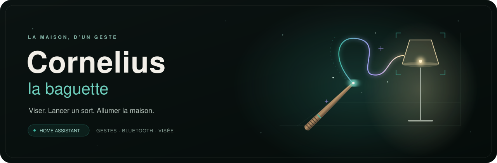

<h3>On vise une lampe, on lance le sort, elle s’allume.</h3>

  
  
  
  
  
  

  <a href="#-ce-quelle-fait">La baguette</a> ·
  <a href="#-ce-quil-faut">Matériel</a> ·
  <a href="#-premiers-sorts">Premiers sorts</a> ·
  <a href="docs/guide.md">Guide complet</a> ·
  <a href="docs/developpement.md">Développer</a>

---

**Cornelius Wand** réunit une baguette Arduino, une caméra au plafond et une intégration Home Assistant. Le geste choisit le sort ; la direction du bras et l’inclinaison de la baguette choisissent la cible. Vos automatisations Home Assistant font le reste.

La baguette fonctionne directement avec Home Assistant, sans serveur Cornelius à installer.

## ✨ Ce qu’elle fait

<table>
  <tr>
    <td width="50%" valign="top">
      <h4>🪄 Un geste, un sort</h4>
      Jusqu’à quatre gestes appris avec Edge Impulse, reconnus sur la baguette. Elle se réveille au mouvement et se rendort quand on la pose.
    </td>
    <td width="50%" valign="top">
      <h4>🎯 La bonne cible</h4>
      La caméra retrouve la photo du moment où l’on visait. Jev repère le bras ; l’inclinaison départage le sol, le mur et le plafond.
    </td>
  </tr>
  <tr>
    <td valign="top">
      <h4>🏠 Vos automatisations</h4>
      Chaque sort devient un événement Home Assistant avec sa cible. Allumer une lampe, basculer une prise ou lancer une scène se règle comme d’habitude.
    </td>
    <td valign="top">
      <h4>🖱️ Tout à portée de clic</h4>
      Le panneau <b>Baguette</b> permet de placer les cibles sur la photo et de vérifier la visée. Calibration et réglages passent ensuite par Bluetooth, sans rebrancher l’USB.
    </td>
  </tr>
</table>

**Envie de commander par geste seulement ?** Le **Mode sort uniquement** émet le sort dès sa réception, sans photo ni appel à Jev. Pour lancer aussi les gestes sans pause de visée, désactivez **Ignorer les sorts sans visée**.

## 🧰 Ce qu’il faut

| Élément | À prévoir |
|---|---|
| **Baguette** | Arduino Nano 33 BLE Rev2, capteur BMI270 intégré ; vibreur facultatif |
| **Caméra** | Freenove ESP32-WROVER CAM avec OV2640, PSRAM activée, au plafond |
| **Maison** | Home Assistant et un adaptateur Bluetooth ou un proxy ESPHome ; scan actif pour découvrir la baguette, connexions actives pour la régler |
| **Gestes** | Arduino IDE et bibliothèques Arduino ; modèle **Alohomora** fourni dans [model/](model/MagicWand_inferencing-1.0.4.zip), Edge Impulse seulement pour apprendre d’autres gestes |
| **Visée** | Wi-Fi pour la caméra et clé API TypeSafe/Jev ; inutiles en mode sort uniquement |

Un modèle prêt à l’emploi est **fourni** : [model/MagicWand_inferencing-1.0.4.zip](model/MagicWand_inferencing-1.0.4.zip) reconnaît le sort **Alohomora** (et le repos). Il suffit de l’ajouter dans l’Arduino IDE, sans enregistrer ni entraîner de gestes. Il a été appris sur les gestes d’une seule personne : si votre Alohomora est mal reconnu, ou pour d’autres sorts, entraînez votre propre modèle avec Edge Impulse ([guide](docs/guide.md#étape-1--collecter-les-gestes)).

## 🚀 Premiers sorts

1. **Installez le modèle.** Dans l’Arduino IDE, ajoutez la bibliothèque [model/MagicWand_inferencing-1.0.4.zip](model/MagicWand_inferencing-1.0.4.zip) (Croquis → Inclure une bibliothèque → Ajouter la bibliothèque .ZIP). Elle reconnaît Alohomora. Pour d’autres gestes, enregistrez-les avec le sketch [collect](collect/collect.ino) et entraînez votre modèle.
2. **Préparez la baguette.** Téléversez [wand](wand/). [wand/config.h](wand/config.h) associe déjà Alohomora au bouton 1 ; avec votre propre modèle, associez-y vos gestes.
3. **Installez la caméra.** Copiez [secrets.example.h](camera/secrets.example.h) en `camera/secrets.h`, renseignez le Wi-Fi et téléversez [camera](camera/). Vérifiez le cadrage depuis sa page locale.
4. **Ajoutez l’intégration.** Depuis le **Marketplace** de Home Assistant (2026.11 et plus) : , ou **Paramètres → Marketplace → ⋮ → Dépôts personnalisés**, avec l’adresse `https://github.com/lfpoulain/Cornelius-Wand` et la catégorie **Intégration**. Sinon, copiez [custom_components/cornelius_wand](custom_components/cornelius_wand/) dans `/config/custom_components/` et redémarrez. Réveillez ensuite la baguette, puis configurez les sorts, la caméra et la clé API TypeSafe.
5. **Visez.** Calibrez l’axe de la baguette, placez les cibles dans le panneau **Baguette**, puis créez une automatisation par sort avec le [blueprint](blueprints/automation/cornelius_wand/sort.yaml) : une action par cible.

**[Suivre le guide complet →](docs/guide.md)** — collecte, branchement, calibration, réglages et exemple d’automatisation.

## 🔒 Photos et commandes

La reconnaissance des gestes tourne **sur la baguette**. Pour trouver une cible, Home Assistant envoie une photo de la pièce à **TypeSafe/Jev dès la fin d’une pause de visée**, même si aucun sort ne suit. Le panneau en envoie aussi une à chaque vérification. Le [guide détaille les déclenchements et les moyens de couper la vision](docs/guide.md#jev).

Les annonces BTHome et le service Bluetooth des réglages ne sont pas authentifiés. La caméra sert ses photos en HTTP **sans authentification** : elle doit rester sur un réseau de confiance, sans exposition à Internet. Les clés et les photos personnelles restent hors du dépôt.

## 🗂️ Dans le dépôt

| Dossier | Rôle |
|---|---|
| [wand/](wand/) | firmware de la baguette : capteurs, gestes, visée, Bluetooth, veille |
| [camera/](camera/) | firmware de la caméra et historique des photos |
| [custom_components/cornelius_wand/](custom_components/cornelius_wand/) | intégration, entités Home Assistant et panneau de placement |
| [model/](model/) | modèle Alohomora prêt à installer (bibliothèque Arduino exportée d’Edge Impulse) |
| [collect/](collect/) · [test-model/](test-model/) | enregistrer les gestes et essayer le modèle |
| [blueprints/](blueprints/automation/cornelius_wand/) | blueprint Home Assistant : une automatisation par sort, une action par cible |
| [bench/](bench/) | mesurer la précision et le temps de réponse de Jev |
| [tests/](tests/) | tests Python et régressions du panneau en JavaScript |
| [docs/](docs/README.md) | guide, architecture et développement |

## 🧪 État du projet

Projet **expérimental**, avec des tests automatisés pour la logique de visée, l’intégration et le panneau. La CI vérifie Python et JavaScript sous Ubuntu ; elle ne compile pas les sketches Arduino. Les tests en simulation ne remplacent pas les essais sur les cartes, et la précision de la visée dépend du modèle, du cadrage et de l’éclairage.

Pour travailler dessus : [développement](docs/developpement.md), [contribution](CONTRIBUTING.md), [historique](CHANGELOG.md).

## 📜 Licence

Projet libre sous [licence MIT](LICENSE) : utilisez-le, modifiez-le et partagez-le comme vous voulez, en gardant la mention de copyright. Le SDK Edge Impulse inclus dans [model/](model/) garde ses propres licences (Apache 2.0 et BSD), jointes dans le zip.
