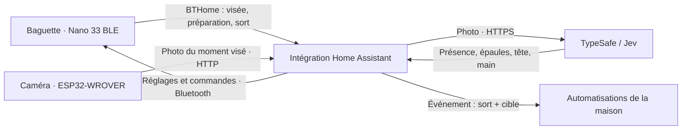

# Architecture

[Accueil](../README.md) · [Documentation](README.md) · [Guide](guide.md) · [Développement](developpement.md)

Trois appareils coopèrent : la baguette reconnaît le geste, la caméra conserve les images récentes, Home Assistant décide de la cible et émet l’événement. L’analyse du bras est confiée à TypeSafe/Jev. Le serveur du miroir Cornelius ne participe pas à ce parcours.

## Le trajet d’un sort

1. La baguette détecte une pause de visée, mémorise l’inclinaison et annonce la fin de la pause.
2. Home Assistant demande à la caméra une photo de cet instant. La caméra conserve au moins 2,6 secondes d’images dans un tampon circulaire en PSRAM.
3. Pendant le geste, Jev cherche la personne et sa main. La préparation puis le sort réutilisent cette analyse si l’instant visé correspond encore.
4. Home Assistant compare la direction tête → main (centre des épaules si la tête manque) à celle des cibles placées dans le panneau. L’inclinaison filtre leur surface : sol, mur ou plafond.
5. L’intégration émet le sort avec la cible, ou sans cible si la visée est absente, ambiguë, invalide ou trop lente. Une automatisation choisit l’action à effectuer.

La vision dispose de **1,5 seconde au maximum après l’annonce du sort**. Le mode sort uniquement court-circuite caméra et Jev. Le panneau peut toujours demander une analyse manuelle lorsqu’ils sont configurés.

## Les responsabilités dans le code

| Module | Responsabilité |
|---|---|
| [wand/sampler.cpp](../wand/sampler.cpp) | acquisition et fenêtre des mesures du capteur |
| [wand/gestures.cpp](../wand/gestures.cpp) | inférence Edge Impulse et validation des gestes |
| [wand/orientation.cpp](../wand/orientation.cpp) | calibration, immobilité et instant de visée |
| [wand/bthome.cpp](../wand/bthome.cpp) | annonces de présence, visée, préparation et sort |
| [wand/remote.cpp](../wand/remote.cpp) · [settings.cpp](../wand/settings.cpp) | commandes Bluetooth et réglages persistants |
| [wand/power.cpp](../wand/power.cpp) | veille et réveil par mouvement |
| [camera/camera.ino](../camera/camera.ino) | capture, historique en PSRAM, HTTP et OTA |
| [parser.py](../custom_components/cornelius_wand/parser.py) | décodage des annonces BTHome |
| [wand.py](../custom_components/cornelius_wand/wand.py) | état par baguette, tâches asynchrones, déduplication, stockage et événements |
| [vision.py](../custom_components/cornelius_wand/vision.py) | photo HTTP, appel Jev et validation de la réponse |
| [aim.py](../custom_components/cornelius_wand/aim.py) | choix géométrique de la cible, sans dépendance Home Assistant |
| [remote.py](../custom_components/cornelius_wand/remote.py) | échanges Bluetooth depuis Home Assistant |
| [panel.py](../custom_components/cornelius_wand/panel.py) · [panel.js](../custom_components/cornelius_wand/www/panel.js) | commandes websocket administrateur et interface de placement |
| [overlay.py](../custom_components/cornelius_wand/overlay.py) | annotation de la dernière photo analysée |

## Les données et les limites de confiance

Les cibles et les réglages Home Assistant sont enregistrés par baguette dans son stockage d’intégration. Les réglages reçus par la baguette restent dans sa flash. Les options Home Assistant contiennent la clé API TypeSafe ; les sauvegardes qui l’incluent doivent rester privées.

Les annonces BTHome et le service Bluetooth des réglages ne sont pas authentifiés. La caméra expose ses photos en HTTP sans authentification. Le fonctionnement suppose donc un environnement Bluetooth et un réseau local de confiance.

Une présence Jev absente ou invalide ne permet pas d’exploiter les cadres. Une main introuvable ne peut pas désigner un plafonnier par proximité ; ce cas de secours est réservé à une main détectée trop près des épaules pour fournir une direction fiable.

La reconnaissance réelle dépend du modèle appris, du cadrage, de l’éclairage et des réponses de Jev. Les tests automatisés vérifient la logique avec des données contrôlées ; ils ne mesurent pas à eux seuls la précision dans une autre pièce.
